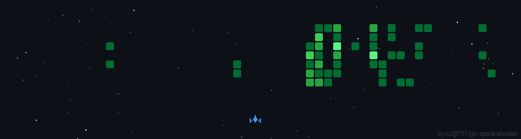

<div align="center">


<br>


<br><br>


</div>

<br>

```text
widad@lifemedia-node01:~# neofetch
-----------------------------------
OS         : Debian / Ubuntu Server / Proxmox VE
Role       : Infrastructure Engineer & Backend Developer
Host       : LifeMedia Enterprise Infrastructure
Network    : MikroTik RouterOS | FTTH | VLAN | WireGuard
Stack      : Linux · Docker · PHP / Laravel · Python · Bash
Uptime     : 99.9% High Availability
Status     : Deploying & Automating 🚀
```

---

## 📌 About Me

I'm an **Infrastructure Engineer and Backend Developer** specializing in Linux server administration, enterprise networking, virtualization, and backend application development.

- 🏢 Currently engineering infrastructure and operational deployments at **LifeMedia**.
- 🛠️ Bridging the gap between hardware/virtualization layers and application backend code.
- 🎯 Core focus: Server hardening, network routing & security, high availability, and operational automation.

---

## 🛠️ Tech Stack & Tooling

### 🖥️ Infrastructure & Virtualization

<div align="center">


<br><br>


</div>

### 🌐 Networking & Security

<div align="center">


<br><br>

`Routing` &nbsp;•&nbsp; `VLAN Segmentation` &nbsp;•&nbsp; `Firewall Policy` &nbsp;•&nbsp; `VPN Tunnels` &nbsp;•&nbsp; `FTTH Architecture`

</div>

### ⚡ Backend & Databases

<div align="center">


<br><br>


</div>

### 🚀 DevOps, Cloud & Monitoring (Active Exploration)

<div align="center">


<br><br>


</div>

---

## 🏛️ Engineering Pillars

<table>
<tr>
<td width="50%" valign="top">

### 🖥️ 01. Systems & Infrastructure
- Linux server hardening & administration (Debian/Ubuntu/RHEL).
- Virtualization clusters using Proxmox VE.
- Containerization and orchestration with Docker.
- Storage, automated snapshots, and disaster recovery.

</td>

<td width="50%" valign="top">

### 🌐 02. Network Engineering
- MikroTik RouterOS deployment, bandwidth queuing, and BGP/OSPF.
- Enterprise VLAN segmentation & network firewall policies.
- Secure site-to-site VPN tunnels (WireGuard, IPsec, OpenVPN).
- FTTH infrastructure support and ISP network operations.

</td>
</tr>

<tr>
<td width="50%" valign="top">

### ⚡ 03. Backend Development
- Scalable RESTful API design using PHP & Laravel.
- Automation scripts, web scraping, and microservices in Python.
- Database optimization, indexing, and management (MySQL/PostgreSQL).
- Secure authentication, caching, and rate limiting.

</td>

<td width="50%" valign="top">

### 🤖 04. Automation & Observability
- Shell/Bash scripting for automated maintenance tasks.
- CI/CD build & deployment pipelines using GitHub Actions.
- Server health metrics collection and uptime alerting.
- Infrastructure as Code workflows for reproducible setups.

</td>
</tr>
</table>

---

## 📊 GitHub Analytics

<div align="center">


&nbsp;


<br><br>


</div>

---

## 👾 Contribution Galaxy

<div align="center">



</div>

---

## 📬 Connect & Collaborate

<div align="center">

<a href="https://github.com/widad-sksn">
  
</a>
&nbsp;
<a href="https://linkedin.com/in/widad-sksn">
  
</a>
&nbsp;
<a href="mailto:widad.sksn@gmail.com">
  
</a>

</div>

<br>

<div align="center">


</div>
